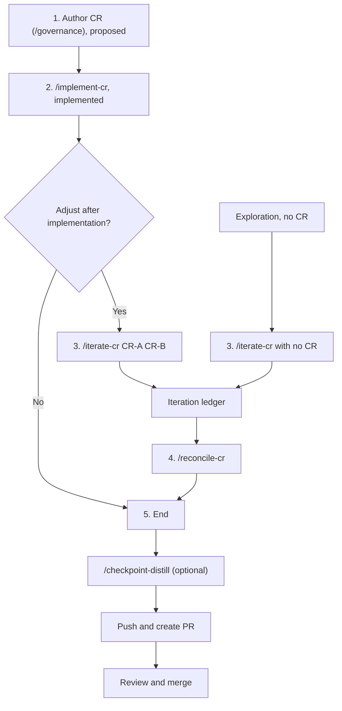
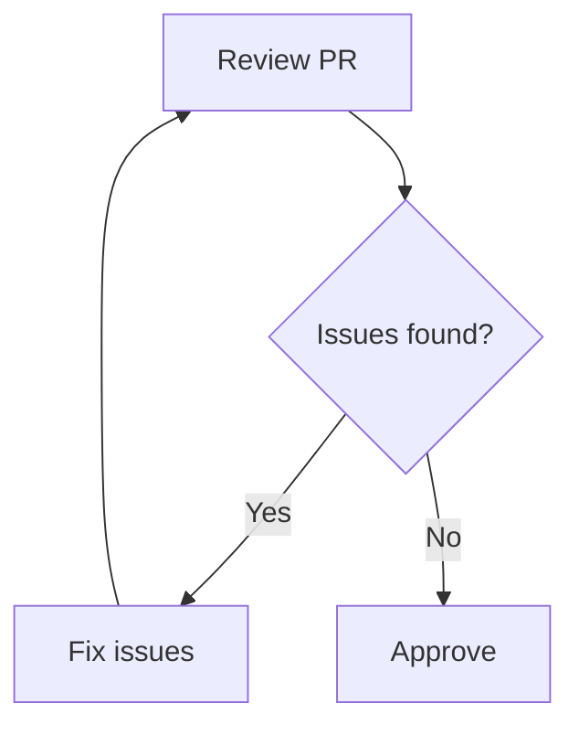
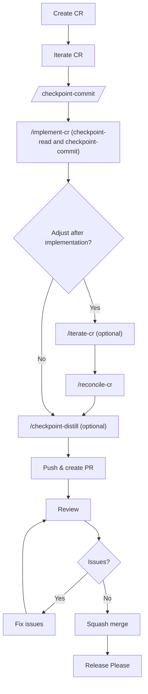

# Implementation Workflow

This document describes the end-to-end workflow for implementing changes in this repository using AI agents, Change Requests (CRs), and checkpoint commits.

### Overview

The Change Request lifecycle has five steps: **author**, **implement**, **iterate** (optional), **reconcile**, and **end**. Distillation is optional after reconcile, or after implementation when no iteration ran.

### Step 1: Create a Change Request

Ask the AI agent to create a CR for the desired change. The CR captures motivation, current state, proposed changes, and a phased implementation plan.

**Prompt:**
> Create a CR for \<description of the desired change\>

### Step 2: Iterate the CR

Review the generated CR and refine it until it meets quality standards. This can be zero-shot (accepted on first attempt) but is typically few-shot (a few rounds of feedback).

**Prompt (repeat as needed):**
> \<feedback on the CR\>

### Step 3: Checkpoint-commit the finalized CR

Once the CR is finalized, create a checkpoint commit to preserve it.

**Prompt:**
> /checkpoint-commit

### Step 4: Implement with /implement-cr

Run `/implement-cr` with one or many CRs. It resolves every argument first, runs each CR strictly in argument order, stops on the first failed CR, and sets `status: implemented` on each completed CR. It starts with `/checkpoint-read`, and runs it again when it resumes after context loss, so a restarted run continues from the last checkpoint. Each coherent step commits through `/checkpoint-commit` with the CR as scope.

**Prompt:**
> /implement-cr CR-XXXX CR-YYYY

The report ends with one status line per CR and names `/iterate-cr` with every completed CR as the next command for post-implementation adjustment. See the [implement-cr skill](skills/implement-cr/SKILL.md).

### Step 5: Iterate the last mile (optional)

A Change Request is written before the code exists, so the delivered implementation is usually approximately right rather than exactly right. When you are looped in after implementation to adjust or change things, open an iteration session. It is user-initiated and never started automatically.

**Prompt:**
> /iterate-cr CR-XXXX CR-YYYY

One session may cover every CR that one `/implement-cr` run delivered. The agent opens an **iteration ledger** at `docs/cr/iterations/{YYYY-MM-DD}-{slug}.md` whose frontmatter lists the covered CRs, then awaits the next thing to try. The ledger follows a roll-forward model:

- **Kept is implicit** — a change left in the working tree stands.
- **Supersession is explicit** — a later entry names the earlier entry it supersedes and why; the earlier entry is never edited.
- **What stands is derived** — read forward from the entries, honouring supersessions.

Each entry carries an **attribution**: the covered CR whose behaviour it changes, or `none` when it adds behaviour no covered CR describes. The attribution is a proposal; reconcile finalises the routing.

Like `/implement-cr`, the session commits every change through `/checkpoint-commit`, with the code and its ledger entry in one commit, and re-hydrates after context loss with `/checkpoint-read` followed by the ledger. An entry attributed to a CR commits as `checkpoint(CR-XXXX-iterate): {summary}`; an entry attributed `none` commits as `checkpoint(iterate-{slug}): {summary}`. Every session commit carries an `Iteration: {slug}` trailer.

**Exploration entry point.** `/iterate-cr` with no identifier opens an exploration ledger (an empty CR list). The lifecycle then starts here, and reconcile creates the CR afterwards.

See the [iterate-cr skill](skills/iterate-cr/SKILL.md) for the full protocol.

### Step 6: Reconcile the CRs with what stands

After you accept the iteration, run `/reconcile-cr` on the ledger. The ledger is the ground truth for what you want.

**Prompt:**
> /reconcile-cr {ledger path or slug}

The agent derives what stands, routes each standing change by its attribution, and shows one reconciliation plan before it writes anything. On your answer it rewrites each covered CR so it describes the behaviour that stands, moves superseded approaches into Alternative Approaches Considered, and adds a Reconciliation section. Unattributed changes, and every change of an exploration ledger, go into a new **retroactive CR** (status `implemented`, `origin: retroactive`). The ledger is marked reconciled and closed; new adjustments open a new ledger. Reconcile changes no code and makes one `docs(cr)` commit. See the [reconcile-cr skill](skills/reconcile-cr/SKILL.md).

The lifecycle then ends: the CRs are final.

### Step 7: Distil into standing instructions (optional)

Reconcile corrects the record of one change, so that the CR describes the code. Distillation is different: it extracts the lessons that apply to future work and writes them into the project's standing instructions. Run it after reconcile, or after implementation when no iteration ran. A reconciled CR is better input, because its Alternative Approaches Considered hold the superseded approaches with their reasons.

The stage is opt-in and user-initiated. It reads the durable artifacts, ranks candidates into tiers, and writes nothing without per-tier approval. Run it before the branch merges, because the checkpoint commits it reads collapse in a squash merge.

**Prompt:**
> /checkpoint-distill CR-XXXX

See the [checkpoint-distill skill](skills/checkpoint-distill/SKILL.md) for the full protocol.

### Step 8: Push and create a PR

Push the branch and create a pull request.

**Prompt:**
> git push and create a pr

### Step 9: Review

Review the PR for correctness, completeness, and adherence to project standards.

### Step 10: Fix any issues

If the review surfaces issues, fix them and return to step 8.

### Step 11: Merge the PR

Squash merge the PR into `main`. The PR title becomes the commit message and must follow [Conventional Commits](https://www.conventionalcommits.org/).

### Step 12: Release

[Release Please](https://github.com/googleapis/release-please) automatically creates a release PR based on conventional commit messages. Merge the release PR to publish the new version.

### Complete Workflow

