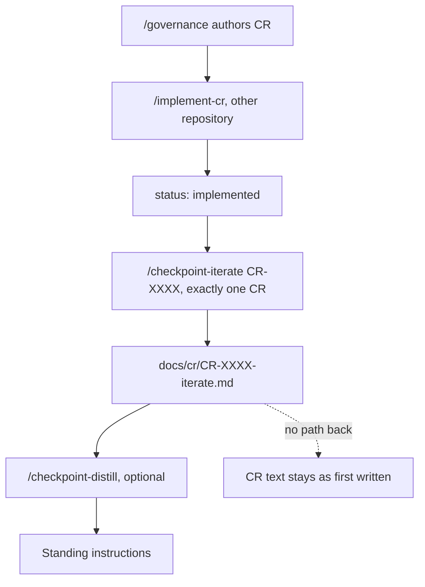
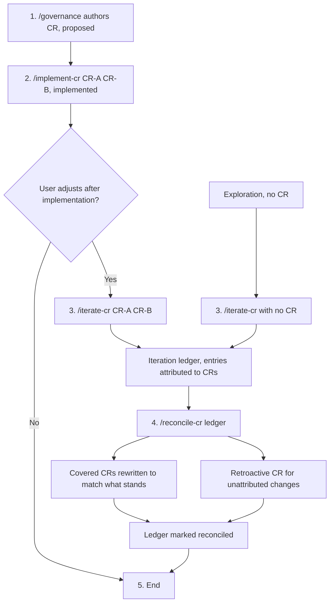
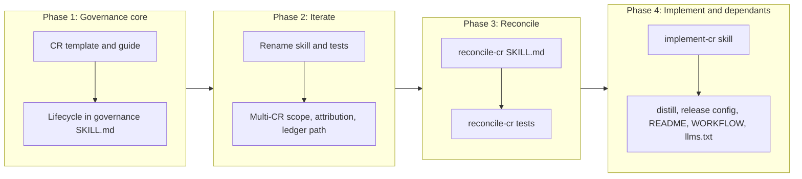

# Iterate and Reconcile: The Change Request Lifecycle Ends on What the User Kept

## Change Summary

Today a Change Request is written once, before the code, and then stops being true the moment a last-mile iteration session changes the behaviour. This CR makes the iteration the authority for what the user actually wanted, and closes the loop back into governance. The lifecycle becomes five steps: author with `/governance`, implement one or many CRs with `/implement-cr`, adjust after implementation with `/iterate-cr` across every CR that was implemented, reconcile with `/reconcile-cr` so each CR describes what was kept, and stop. An iteration may also start with no CR at all, as exploration, in which case `/reconcile-cr` writes a retroactive CR for what was accepted.

## Motivation and Background

**The intent of the user is hard to capture up front.** A CR is a prediction of what the user wants, written before anyone could look at the result. The first implementation is therefore approximately right. The user discovers what they actually meant by looking at the delivered behaviour and asking for adjustments. The iteration session is where the intent becomes visible, not the CR.

**The CR is left describing a change that no longer exists.** `/checkpoint-iterate` records the iteration in a ledger, but nothing carries the result back into the CR. After a session, the CR states requirements and acceptance criteria that the code no longer satisfies, and the ledger states the behaviour the user accepted. A later reader, human or agent, trusts the CR because it is the governance document, and is misled. The operating model requires the layers to stay consistent (intent, then CR, then docs, then code); a session that changes code without a path back to the CR breaks that chain by design.

**Implementation is batched, so iteration must be batched too.** `/implement-cr` already runs several CRs in sequence in one invocation. The user then looks at the combined result, not at each CR alone. A single adjustment often touches behaviour from two CRs. `/checkpoint-iterate` binds one session to one CR, so the user must either open several sessions for one sitting or misattribute changes to whichever CR they opened the session against.

**Exploration has no governance path today.** Some work starts with "let us try something" rather than with a CR. Today that work either skips governance entirely or forces the user to write a speculative CR before they know what they want. With iteration as the ground truth, the honest order is: explore, accept, then write the CR that describes what was accepted.

**The lifecycle is spread over two repositories.** `/implement-cr` lives as a command in a separate agent-configuration repository, while the governance skill, the CR template, and the iteration skill ship from this one. A consumer that installs the governance skills does not get the step that connects authoring to iteration.

## Change Drivers

* User intent is discovered by looking at the delivered result, not by writing the CR
* After an iteration session, the CR no longer describes the code, and nothing reconciles them
* `/implement-cr` runs many CRs in one pass, but `/checkpoint-iterate` covers exactly one
* Exploratory work has no path into governance except a speculative CR written in advance
* The lifecycle has no explicit end state, so a CR is never known to be final
* The implementation step ships from a different repository than the rest of the lifecycle

## Current State

The governance skill authors CRs and ADRs. Its `SKILL.md` names no lifecycle beyond authoring and points to `reference/cr-implementation-workflow.md` for implementation.

`/implement-cr` is a command file at `.claude/commands/implement-cr.md` in the `claude-agent-teams` repository. It resolves each argument to exactly one `docs/cr/CR-NNNN-*.md` that is not a `-validation-report`, `-rollback-log`, or `-iterate` file, runs each CR strictly in argument order through the change flow, and sets `status: implemented` on each completed CR. It ends with a report and names no next step.

`/checkpoint-iterate CR-XXXX` (`skills/checkpoint-iterate/`) opens or resumes a roll-forward ledger at `docs/cr/CR-XXXX-iterate.md`. The invocation **MUST** name exactly one existing CR. Entries record change, reason, evidence, and optional supersession; a derived "What Stands Now" section summarises the result. Commits use `checkpoint(CR-XXXX-iterate): {summary}`. The session draws no conclusions and ends when the user stops.

`/checkpoint-distill` reads the CR, its validation report, the ledger at `docs/cr/CR-XXXX-iterate.md`, and the `checkpoint(CR-XXXX(-iterate)?)` commits, and writes ranked knowledge into the project's standing instructions. It does not change the CR.

Nothing writes the result of an iteration back into a CR.

### Current State Diagram



## Proposed Change

### The Lifecycle

The governance skill documents one lifecycle, with two entry points.

1. **Author.** Create the CR with the `governance` skill. Status `proposed`.
2. **Implement.** Run `/implement-cr` with one or many CRs. Each completed CR gets status `implemented`.
3. **Iterate (optional, user-initiated).** When the user is looped in after implementation to adjust or change things, run `/iterate-cr` with every CR the session covers. One session may cover all CRs that one `/implement-cr` run delivered.
4. **Reconcile.** After the iteration is accepted, run `/reconcile-cr` on the ledger. The ledger is the ground truth for the intent of the user. Each covered CR is rewritten to describe what was kept. Changes that belong to no covered CR go into a new retroactive CR.
5. **End.** The ledger is marked reconciled and the CRs are final. The lifecycle has ended.

**Exploration entry point.** A session may start at step 3 with no CR: `/iterate-cr` with no identifier opens an exploration ledger. When the user accepts the result, `/reconcile-cr` creates one retroactive CR (or more, if the work splits into independent changes) that describes what was accepted, with status `implemented`.

When step 3 does not happen, the lifecycle ends after step 2. `/checkpoint-distill` stays optional after step 4, or after step 2 when no iteration ran, and its purpose does not change: reconcile corrects the record of one change, so that the CR describes the code; distill extracts the lessons that apply to future work and writes them into the project's standing instructions. A reconciled CR is better distill input, because its Alternative Approaches Considered now hold the superseded approaches with their reasons.

**Checkpoint skills across the lifecycle.** Every step that changes code commits through `/checkpoint-commit`, and every step that changes code starts, and resumes after context loss, with `/checkpoint-read`. `/implement-cr` and `/iterate-cr` therefore share one commit mechanism and one context-recovery mechanism. `/reconcile-cr` changes no code: it makes one `docs(cr)` commit and reads the session commits with a scoped `git log` query, because `/checkpoint-read` reads only the most recent checkpoint and has no CR or session filter.

### Proposed State Diagram



### `/iterate-cr` Replaces `/checkpoint-iterate`

The skill `checkpoint-iterate` is renamed to `iterate-cr`. The roll-forward model of CR-0017 is kept without change: kept is implicit, supersession is explicit, what stands is derived, the user drives the loop, and the session draws no conclusions. Four things change.

* **Scope is zero, one, or many CRs.** `/iterate-cr CR-0019 CR-0020` covers both. `/iterate-cr` with no identifier opens an exploration session. Every named CR **MUST** resolve to an existing CR document.
* **The ledger has its own identity.** Because a ledger is no longer owned by one CR, it lives at `docs/cr/iterations/{YYYY-MM-DD}-{slug}.md`. Its frontmatter lists the covered CRs (`crs:`, empty for exploration), the start state (branch, commit, worktree), and the reconciliation marker that `/reconcile-cr` sets (`reconciled:` date and `reconciled-into:` list, both absent until then).
* **Each entry carries an attribution.** An entry names the CR whose behaviour it changes (`CR:` field), or `none` when it adds behaviour that no covered CR describes. The agent writes the attribution as part of the entry, the same way it writes the reason and the evidence. The attribution is a proposal; `/reconcile-cr` finalises the routing.
* **Checkpoint commits stay the backbone of the session.** Every change is committed continuously, on the agent's own initiative, through the `/checkpoint-commit` workflow, with the code and its ledger entry in the same commit. The commit scope follows the attribution of the entry, so the existing per-CR convention survives a multi-CR session: an entry attributed to `CR-XXXX` commits as `checkpoint(CR-XXXX-iterate): {summary}`, and an entry attributed `none` commits as `checkpoint(iterate-{slug}): {summary}`. Every session commit carries an `Iteration: {slug}` trailer. The commit body restates the change, the reason, and the evidence as bullet points, so the commit is a self-contained copy of its entry.

The checkpoint commits give three things that the ledger alone does not. First, `git log --grep '^checkpoint(CR-XXXX-iterate):'` finds every change a session made to one CR, across sessions, which is the per-CR history that `/checkpoint-distill` and `/checkpoint-read` already query. Second, `git log --grep 'Iteration: {slug}'` finds every commit of one session, whatever CR it touched. Third, each entry maps to exactly one commit, so the diff of that commit is the evidence of what the entry changed. Re-hydration after context loss starts with `/checkpoint-read` for the most recent checkpoint, then reads the ledger and the session commits with the scoped queries above. Staging stays scoped to the paths the change touched, never the whole tree.

A reconciled ledger is closed: `/iterate-cr` **MUST NOT** append to a ledger that carries `reconciled:`. New adjustments open a new ledger.

**Legacy ledgers.** A ledger at `docs/cr/CR-XXXX-iterate.md` from `/checkpoint-iterate` stays valid input. `/iterate-cr CR-XXXX` resumes it in place when it is the only open ledger that covers that CR, and `/reconcile-cr` accepts it. Its `checkpoint(CR-XXXX-iterate)` commits stay recognised.

### `/reconcile-cr` (New)

`/reconcile-cr {ledger path or slug}` reconciles one ledger into governance. With no argument and exactly one unreconciled ledger in the tree, it uses that ledger; with more than one, it refuses and lists them.

The procedure:

1. **Derive what stands.** Read the ledger entries in order, honour every supersession, and map each entry to the checkpoint commit that added it (`git log --grep 'Iteration: {slug}'`, or the `checkpoint(CR-XXXX-iterate)` commits for a legacy ledger). Compare the derived state with the working tree; uncommitted changes to files that the ledger entries touch stop the reconcile, because the ground truth must be committed. The checkpoint commits are the evidence; the ledger is the narrative.
2. **Route each standing change.** Group the standing changes by their attribution. Confirm each attribution against the diff of its checkpoint commit. A change whose attribution is ambiguous, or which touches behaviour of two CRs, is routed by the agent to the CR whose requirements it changes, and the routing is listed in the plan.
3. **Show the reconciliation plan once.** Before any document is written, the agent shows one table: each covered CR, the requirements, acceptance criteria, and scope items that change, and each retroactive CR that will be created. The user answers once. This is the only stop of the procedure; it exists because a misrouted change rewrites the wrong governance document.
4. **Rewrite each covered CR in place.** The Proposed Change, Requirements, Scope Boundaries, Acceptance Criteria, and Model-Based Testing sections are changed to describe the behaviour that stands. A superseded approach becomes an entry in Alternative Approaches Considered, with the reason the ledger gives. The original text is not kept inline; Git history holds it.
5. **Record the reconciliation.** Each rewritten CR gets a Reconciliation section: one row per divergence, with the original statement in short form, the reconciled statement, the ledger entry that caused it, and the short SHA of its checkpoint commit. The frontmatter `date` is updated and `reconciled:` is set. Status stays `implemented`.
6. **Create a retroactive CR for unattributed changes.** Changes attributed `none`, and every change of an exploration ledger, go into a new CR from the governance template, with status `implemented`, frontmatter `origin: retroactive`, and the ledger path in Related Items. The retroactive CR is a complete CR, with requirements and Gherkin acceptance criteria that the standing code satisfies.
7. **Keep Layer 2 consistent.** When a document under `docs/specification/` already describes behaviour that the reconcile changes, that document is updated in the same commit. No new Layer 2 document is created.
8. **Close the ledger.** The ledger frontmatter gets `reconciled:` and `reconciled-into:`. The commit is `docs(cr): reconcile {CR-IDs} with iteration {slug}`.

`/reconcile-cr` changes no code and runs no destructive Git operation. Its output is governance documents only.

### `/implement-cr` Moves Into This Repository

The command is added as the skill `skills/implement-cr/`, with its behaviour preserved: resolve all arguments first, run each CR strictly in argument order, stop on the first failed CR, report one status line per CR, and set `status: implemented`. Four adjustments come with the move.

* **Resolution ignores the new ledger directory.** Files under `docs/cr/iterations/` are never resolved as a CR, next to the existing `-validation-report`, `-rollback-log`, and `-iterate` exclusions.
* **Checkpoint skills carry commits and context.** Each coherent step commits through `/checkpoint-commit` with the scope `CR-NNNN`, instead of a hand-written `checkpoint(CR-NNNN): ...` commit. The skill runs `/checkpoint-read` before the first CR, and again when it resumes after context loss, so a restarted run continues from the last checkpoint rather than from the start of the CR.
* **The report names the next step.** After the status lines, the report names `/iterate-cr` with every completed CR as the command for post-implementation adjustment.
* **Preconditions are stated.** The command depends on the `operating_model`, `subagent_creation`, `task_delegation`, `continuous_commit`, `testing`, and `user_scenario_testing` blocks of the consumer's agent instructions. The skill states this dependency. When those blocks are absent, the skill follows `skills/governance/reference/cr-implementation-workflow.md` instead, so a consumer without them still gets a working implementation step.

## Requirements

### Functional Requirements

**Lifecycle**

1. The governance `SKILL.md` **MUST** document the five-step lifecycle (author, implement, iterate, reconcile, end) and the exploration entry point, with one Mermaid diagram.
2. The governance `SKILL.md` **MUST** state that the iteration ledger is the ground truth for user intent once it is reconciled, and that a CR is final after reconciliation.

**`/iterate-cr`**

3. The skill directory `skills/checkpoint-iterate/` **MUST** be renamed to `skills/iterate-cr/`, with `name: iterate-cr` in its frontmatter.
4. `/iterate-cr` **MUST** accept zero, one, or many CR identifiers, and **MUST** refuse to open a session when any named identifier does not resolve to a CR document, naming the identifier that failed.
5. `/iterate-cr` with no identifier **MUST** open an exploration ledger with an empty `crs:` list.
6. The ledger **MUST** be created at `docs/cr/iterations/{YYYY-MM-DD}-{slug}.md`, from the bundled template, with `crs:`, `opened:`, `source-branch:`, `source-commit:`, and `worktree:` in its frontmatter.
7. Each ledger entry **MUST** carry a `CR:` attribution that names one covered CR or the literal `none`.
8. The roll-forward model of the previous skill **MUST** be kept: no verdict is requested, kept is implicit, supersession names the earlier entry, earlier entries are never edited, and "What Stands Now" is derived.
9. `/iterate-cr` **MUST** commit every change continuously through the `/checkpoint-commit` workflow, without waiting to be asked, with the code change and its ledger entry in the same commit.
10. The subject of a session commit **MUST** be `checkpoint(CR-XXXX-iterate): {summary}` for an entry attributed to `CR-XXXX`, and `checkpoint(iterate-{slug}): {summary}` for an entry attributed `none`.
11. Every session commit **MUST** carry the trailer `Iteration: {slug}`, and its body **MUST** restate the change, the reason, and the evidence of its entry.
12. Session commits **MUST** stage only the paths the change touched and the ledger, never the whole working tree.
13. On resume, `/iterate-cr` **MUST** re-hydrate by running `/checkpoint-read`, then reading the ledger and the session checkpoint commits, and report what stands and which approaches are superseded.
14. `/iterate-cr` **MUST NOT** append to a ledger whose frontmatter carries `reconciled:`, and **MUST** tell the user to open a new session instead.
15. `/iterate-cr` **MUST** resume a legacy ledger at `docs/cr/CR-XXXX-iterate.md` when invoked with that CR and no other open ledger covers it.
16. When more than one unreconciled ledger covers the named CRs, `/iterate-cr` **MUST** refuse and list the ledgers rather than select one.

**`/reconcile-cr`**

17. A new skill `skills/reconcile-cr/` **MUST** be added, invoked as `/reconcile-cr {ledger path or slug}`.
18. `/reconcile-cr` **MUST** refuse to run when the working tree has uncommitted changes to files that the ledger entries touch, and **MUST** name those files.
19. `/reconcile-cr` **MUST** derive what stands from the ledger entries in order, honouring every supersession, and **MUST** map each standing entry to its checkpoint commit and confirm the attribution against that commit's diff.
20. `/reconcile-cr` **MUST** show one reconciliation plan (covered CRs, changed sections, retroactive CRs to create) and wait for one user answer before it writes any document.
21. `/reconcile-cr` **MUST** rewrite the Proposed Change, Requirements, Scope Boundaries, Acceptance Criteria, and Model-Based Testing sections of each covered CR so that they describe the behaviour that stands.
22. `/reconcile-cr` **MUST** add each superseded approach to Alternative Approaches Considered of the CR it was attributed to, with the reason from the ledger.
23. `/reconcile-cr` **MUST** add a Reconciliation section to each rewritten CR, with one row per divergence: original statement, reconciled statement, ledger entry, checkpoint commit.
24. `/reconcile-cr` **MUST** create a retroactive CR, with status `implemented` and `origin: retroactive`, for every standing change attributed `none` and for every standing change of an exploration ledger.
25. `/reconcile-cr` **MUST** update a document under `docs/specification/` only when that document already describes behaviour that the reconcile changes.
26. `/reconcile-cr` **MUST** set `reconciled:` and `reconciled-into:` in the ledger frontmatter and commit with the subject `docs(cr): reconcile {CR-IDs} with iteration {slug}`.
27. `/reconcile-cr` **MUST NOT** change any file outside `docs/`.
28. `/reconcile-cr` **MUST** accept a legacy ledger at `docs/cr/CR-XXXX-iterate.md`, treating every entry as attributed to `CR-XXXX`.

**`/implement-cr`**

29. A new skill `skills/implement-cr/` **MUST** be added, carrying the behaviour of the current command: argument parsing, resolve-all-first, strict argument order, stop on the first failure, one status line per CR, and `status: implemented` on each completed CR.
30. `/implement-cr` **MUST NOT** resolve any file under `docs/cr/iterations/` as a CR.
31. `/implement-cr` **MUST** commit each coherent step through the `/checkpoint-commit` workflow with the scope `CR-NNNN`.
32. `/implement-cr` **MUST** run `/checkpoint-read` before the first CR and when it resumes after context loss, and **MUST** continue from the last checkpoint of the CR in progress.
33. The `/implement-cr` report **MUST** end with the `/iterate-cr` command that covers every completed CR.
34. `/implement-cr` **MUST** state the agent-instruction blocks it depends on, and **MUST** fall back to `skills/governance/reference/cr-implementation-workflow.md` when they are absent.

**Templates, guides, and dependants**

35. The CR template **MUST** gain an optional Reconciliation section and document the optional frontmatter field `origin: retroactive`.
36. `reference/cr-guide.md` **MUST** describe the reconciled state and retroactive CRs.
37. `/checkpoint-distill` **MUST** resolve ledgers under `docs/cr/iterations/` whose `crs:` lists the target CR, keep resolving the legacy path, and keep matching the `checkpoint(CR-XXXX-iterate)` commits.
38. `/checkpoint-commit` **MUST** accept an explicit scope from its caller (`CR-XXXX-iterate` or `iterate-{slug}`) and a trailer, and **MUST** skip its CR detection and its `git add -A` when the caller passes a scope and an explicit path list.

### Non-Functional Requirements

1. Each new or changed `SKILL.md` **MUST** stay under 500 lines, per the Agent Skills best practices.
2. Every new file **MUST** carry the copyright header of `AGENTS.md`, except governance documents and the two governance templates.
3. No governance identifier **MUST** appear in skill prose as a reference to a specific CR; placeholders such as `CR-XXXX` are permitted, per the governance reference boundary.
4. Every skill **MUST** be registered in `release-please-config.json` and `.release-please-manifest.json`, and `checkpoint-iterate` **MUST** be removed from both.
5. The full Bats suite **MUST** pass with `bats -r tests/`.

## Affected Components

* `skills/governance/SKILL.md`: lifecycle section and diagram
* `skills/governance/templates/CR.md`: Reconciliation section, `origin` field
* `skills/governance/reference/cr-guide.md`: reconciled and retroactive CRs
* `skills/checkpoint-iterate/` renamed to `skills/iterate-cr/` (`SKILL.md`, `templates/ITERATE.md`, `version.txt`, `CHANGELOG.md`)
* `skills/reconcile-cr/` (new: `SKILL.md`, `version.txt`)
* `skills/implement-cr/` (new: `SKILL.md`, `version.txt`)
* `skills/checkpoint-distill/SKILL.md`: ledger resolution
* `skills/checkpoint-commit/SKILL.md`: caller-supplied scope, trailer, and path list
* `release-please-config.json`, `.release-please-manifest.json`
* `README.md`, `WORKFLOW.md`, `docs/llms.txt`
* `tests/checkpoint-iterate/` renamed to `tests/iterate-cr/`; new `tests/reconcile-cr/`, `tests/implement-cr/`; `tests/governance/` additions

## Scope Boundaries

### In Scope

* The lifecycle documentation in the governance skill
* The rename and extension of the iteration skill
* The new reconcile skill
* The move of `/implement-cr` into this repository as a skill, with the four stated adjustments
* The CR template, CR guide, distill skill, release configuration, README, WORKFLOW, and llms.txt changes that the above needs
* Tests for all of the above

### Out of Scope ("Here, But Not Further")

* Removal of `.claude/commands/implement-cr.md` from the `claude-agent-teams` repository. That is a change in another repository, done by the owner after this CR ships.
* Merging `reference/cr-implementation-workflow.md` with `/implement-cr`. The reference stays as the fallback; a merge is a later CR.
* Any change to what `/checkpoint-distill` concludes or writes. Only its input resolution changes.
* Reconciliation of ADRs. An iteration that contradicts an ADR is reported by `/reconcile-cr`, not rewritten.
* Automatic start of `/iterate-cr` or `/reconcile-cr`. Both stay user-initiated.
* The presentation deck under `deck/` and `docs/deck/`. It keeps describing the previous skill name until a later change updates it.
* Migration of existing legacy ledgers to the new location. They stay where they are and stay readable.

## Alternative Approaches Considered

* **Keep `/checkpoint-iterate` and add `/iterate-cr` next to it.** Rejected by the requestor: two skills with almost the same job, and the user must choose between them for every session.
* **Extend `/checkpoint-iterate` without a rename.** Rejected: the lifecycle names the steps `implement-cr`, `iterate-cr`, `reconcile-cr`, and a fourth name breaks the pattern the user learns.
* **Append a "what changed after iteration" section to the CR and keep the original text.** Rejected: the CR would then hold two competing specifications, and a reader must work out which one is true. In-place rewrite with a Reconciliation table keeps one specification and one audit trail; Git holds the original.
* **Write a new superseding CR for every iteration.** Rejected: the CR count grows with every adjustment, and the specification of one feature spreads over several documents. Retroactive CRs are created only for behaviour no covered CR describes.
* **Let `/checkpoint-distill` do the reconciliation.** Rejected: distill writes standing instructions for future sessions, and reconcile corrects the record of a specific change. One skill, one job, per CR-0017.
* **Reconcile without a plan confirmation.** Rejected: a misrouted change rewrites the wrong CR, and the user is the only party who knows which CR they meant. One confirmation per reconcile is the minimum.

## Impact Assessment

### User Impact

The user learns one lifecycle with three slash commands that share a naming pattern. After an iteration, the CR again describes the code, so the next session reads a correct specification. The user can explore without writing a CR first. Consumers of `checkpoint-iterate` must install `iterate-cr` instead. The command changes name; the `checkpoint(CR-XXXX-iterate)` commit form stays, and only changes with no CR use the new `checkpoint(iterate-{slug})` scope.

### Technical Impact

* Breaking change for the `checkpoint-iterate` package: the skill name and the ledger path for new sessions change. The per-CR checkpoint commit form does not change. Release Please gets a `feat!` commit for the rename.
* New packages `iterate-cr`, `reconcile-cr`, `implement-cr` start at `0.0.0`.
* `/checkpoint-distill` reads two ledger locations and two commit forms.
* Retroactive CRs make CR numbering non-chronological with respect to implementation, which is accepted; the `origin` field states it.

### Business Impact

Governance documents stay true after the iteration, so audit and onboarding can trust them. Exploration gets a governed path, which reduces untracked changes.

## Implementation Approach

### Implementation Flow



### Detailed Implementation Steps

1. **Phase 1.** Add the Reconciliation section and the `origin` field to `templates/CR.md`. Add a "Reconciled and Retroactive CRs" section to `reference/cr-guide.md`. Add a "CR Lifecycle" section with the diagram to the governance `SKILL.md`.
2. **Phase 2.** `git mv skills/checkpoint-iterate skills/iterate-cr` and `git mv tests/checkpoint-iterate tests/iterate-cr`. Change the frontmatter name, invocation table, scope resolution, ledger path, attribution field, commit protocol, closed-ledger rule, and legacy handling in `SKILL.md`. Add `crs:`, `reconciled:`, `reconciled-into:`, and the `CR:` entry field to `templates/ITERATE.md`. Update the tests.
3. **Phase 3.** Write `skills/reconcile-cr/SKILL.md` with the eight-step procedure and its safety rules. Add `version.txt` and tests.
4. **Phase 4.** Copy the content of `implement-cr.md` from the `claude-agent-teams` repository into `skills/implement-cr/SKILL.md`, add skill frontmatter, and apply the four adjustments. Update `/checkpoint-distill` input resolution. Update release configuration, README skill table, WORKFLOW stages, and `docs/llms.txt`.

## Test Strategy

### Tests to Add

| Test File | Test Name | Description | Inputs | Expected Output |
|-----------|-----------|-------------|--------|-----------------|
| `tests/governance/test_lifecycle.bats` | `governance SKILL.md documents the five-step lifecycle` | Lifecycle section names the five steps | `skills/governance/SKILL.md` | Contains `/implement-cr`, `/iterate-cr`, `/reconcile-cr` in one section |
| `tests/governance/test_lifecycle.bats` | `governance SKILL.md documents the exploration entry point` | Exploration path is stated | same | Contains "exploration" and "retroactive" |
| `tests/governance/test_cr_template.bats` | `CR template has optional Reconciliation section` | Section and optional marker present | `templates/CR.md` | `## Reconciliation` preceded by the optional-element comment |
| `tests/governance/test_cr_template.bats` | `CR template documents origin retroactive` | Field documented | same | Contains `origin` and `retroactive` |
| `tests/iterate-cr/test_skill_structure.bats` | `SKILL.md accepts zero, one, or many CRs` | Invocation table covers all three | `skills/iterate-cr/SKILL.md` | Three invocation rows |
| `tests/iterate-cr/test_skill_structure.bats` | `SKILL.md refuses to append to a reconciled ledger` | Closed-ledger rule | same | Contains `reconciled:` with MUST NOT |
| `tests/iterate-cr/test_skill_structure.bats` | `SKILL.md commits through checkpoint-commit` | Commit backbone | same | Contains `/checkpoint-commit` and the same-commit rule |
| `tests/iterate-cr/test_skill_structure.bats` | `SKILL.md scopes commits by attribution` | Commit protocol | same | Contains `checkpoint(CR-XXXX-iterate)`, `checkpoint(iterate-`, and `Iteration:` |
| `tests/iterate-cr/test_skill_structure.bats` | `SKILL.md re-hydrates from ledger and checkpoints` | Resume | same | Re-hydration step names `/checkpoint-read` and the scoped query |
| `tests/implement-cr/test_skill_structure.bats` | `SKILL.md commits through checkpoint-commit` | Commit mechanism | `skills/implement-cr/SKILL.md` | Contains `/checkpoint-commit` |
| `tests/implement-cr/test_skill_structure.bats` | `SKILL.md recovers context with checkpoint-read` | Resume | same | Contains `/checkpoint-read` in the start and resume rule |
| `tests/reconcile-cr/test_skill_structure.bats` | `SKILL.md maps entries to checkpoint commits` | Evidence | `skills/reconcile-cr/SKILL.md` | Contains `Iteration:` query and the diff confirmation |
| `tests/checkpoint-commit/test_skill_structure.bats` | `SKILL.md accepts a caller scope and path list` | Caller contract | `skills/checkpoint-commit/SKILL.md` | Contains the caller-scope rule |
| `tests/iterate-cr/test_iterate_template.bats` | `template frontmatter has crs and reconciliation fields` | Frontmatter | `templates/ITERATE.md` | `crs:`, `reconciled:`, `reconciled-into:` |
| `tests/iterate-cr/test_iterate_template.bats` | `template entry has a CR attribution field` | Entry shape | same | `**CR:**` in the entry shape |
| `tests/reconcile-cr/test_skill_structure.bats` | `SKILL.md exists with required frontmatter` | Structure | `skills/reconcile-cr/SKILL.md` | name, description, license, metadata |
| `tests/reconcile-cr/test_skill_structure.bats` | `SKILL.md shows one plan before it writes` | Confirmation stop | same | Plan step precedes rewrite step |
| `tests/reconcile-cr/test_skill_structure.bats` | `SKILL.md creates retroactive CRs` | Retroactive path | same | `origin: retroactive` and `implemented` |
| `tests/reconcile-cr/test_skill_structure.bats` | `SKILL.md changes no file outside docs` | Boundary | same | MUST NOT rule present |
| `tests/reconcile-cr/test_skill_structure.bats` | `SKILL.md contains no destructive Git commands` | Safety | same | No unguarded reset, rebase, amend, force push |
| `tests/reconcile-cr/test_skill_structure.bats` | `skill is registered for release` | Release config | config and manifest | `skills/reconcile-cr` in both |
| `tests/implement-cr/test_skill_structure.bats` | `SKILL.md exists with required frontmatter` | Structure | `skills/implement-cr/SKILL.md` | name, description, license, metadata |
| `tests/implement-cr/test_skill_structure.bats` | `SKILL.md excludes the iterations directory` | Resolution | same | Contains `docs/cr/iterations/` with exclusion |
| `tests/implement-cr/test_skill_structure.bats` | `SKILL.md report names iterate-cr` | Next step | same | Report section contains `/iterate-cr` |
| `tests/implement-cr/test_skill_structure.bats` | `SKILL.md states preconditions and fallback` | Degrade path | same | Contains `cr-implementation-workflow.md` |
| `tests/implement-cr/test_skill_structure.bats` | `skill is registered for release` | Release config | config and manifest | `skills/implement-cr` in both |

### Tests to Modify

| Test File | Test Name | Current Behavior | New Behavior | Reason for Change |
|-----------|-----------|------------------|--------------|-------------------|
| `tests/iterate-cr/test_helpers/setup.bash` | (helper) | Points at `skills/checkpoint-iterate` | Points at `skills/iterate-cr` | Rename |
| `tests/iterate-cr/test_skill_structure.bats` | `release-please-config contains checkpoint-iterate component` | Asserts old component | Asserts `iterate-cr` component | Rename |
| `tests/iterate-cr/test_skill_structure.bats` | single-CR identification tests | Assert exactly one CR per invocation | Assert each named CR resolves, and refusal on ambiguous ledgers | Multi-CR scope |
| `tests/iterate-cr/test_iterate_template.bats` | ledger path and frontmatter tests | Assert `cr:` and `CR-XXXX-iterate.md` | Assert `crs:` and `docs/cr/iterations/` | New ledger identity |
| `tests/checkpoint-distill/test_skill_structure.bats` | ledger input tests | Assert one ledger path | Assert both ledger paths | Distill reads both |

### Tests to Remove

| Test File | Test Name | Reason for Removal |
|-----------|-----------|-------------------|
| none | none | The `checkpoint(CR-XXXX-iterate)` form stays in use, so no commit-protocol test becomes obsolete |

## Model-Based Testing

| Scenario | User Goal | User Surface | Success Condition | Criteria Proved | Scenario Record |
|----------|-----------|--------------|-------------------|-----------------|-----------------|
| Multi-CR iteration | Adjust the combined result of two implemented CRs in one session | command line | `docs/cr/iterations/*.md` exists with both CRs in `crs:` and each entry has a `CR:` attribution | AC-2, AC-3 | |
| Reconcile into the right CR | Make each CR describe what was kept | command line | Each covered CR has a Reconciliation section whose rows match the standing entries, and the ledger has `reconciled:` | AC-7, AC-8, AC-10 | |
| Exploration to retroactive CR | Turn an accepted exploration into a governed change | command line | A new `docs/cr/CR-NNNN-*.md` exists with `status: implemented` and `origin: retroactive` | AC-4, AC-11 | |

## Acceptance Criteria

### AC-1: The lifecycle is documented in the governance skill

```gherkin
Given the governance SKILL.md
When a reader opens the CR Lifecycle section
Then it names the steps author, implement, iterate, reconcile, and end in that order
  And it names /implement-cr, /iterate-cr, and /reconcile-cr
  And it describes the exploration entry point that starts at /iterate-cr
```

### AC-2: One session covers many CRs

```gherkin
Given CR-A and CR-B both have status implemented
When the user runs /iterate-cr CR-A CR-B
Then a ledger is created under docs/cr/iterations/
  And its crs field lists CR-A and CR-B
```

### AC-3: Every entry is attributed

```gherkin
Given an open ledger that covers CR-A and CR-B
When the agent appends an entry for a change
Then the entry has a CR field that names CR-A, CR-B, or none
```

### AC-3a: Every change is a checkpoint commit

```gherkin
Given an open ledger that covers CR-A
When the agent makes a change attributed to CR-A
Then one commit holds the code change and its ledger entry
  And its subject starts with checkpoint(CR-A-iterate):
  And it carries the trailer Iteration: {slug}
  And git log --grep '^checkpoint.*:' lists it
  And /checkpoint-read reports it when it is the most recent checkpoint
```

### AC-3b: Unattributed changes use the session scope

```gherkin
Given an open exploration ledger with slug {slug}
When the agent makes a change
Then its commit subject starts with checkpoint(iterate-{slug}):
```

### AC-4: Exploration opens without a CR

```gherkin
Given no CR is named
When the user runs /iterate-cr
Then a ledger is created under docs/cr/iterations/ with an empty crs list
```

### AC-5: Unresolved identifiers are refused

```gherkin
Given CR-9999 has no document under docs/cr/
When the user runs /iterate-cr CR-0001 CR-9999
Then no ledger is created
  And the agent names CR-9999 as the identifier that failed
```

### AC-6: A reconciled ledger is closed

```gherkin
Given a ledger whose frontmatter carries reconciled
When the user runs /iterate-cr with the CRs it covers
Then the agent does not append to that ledger
  And the agent tells the user to open a new session
```

### AC-7: Reconcile shows one plan before it writes

```gherkin
Given an unreconciled ledger with standing changes
When the user runs /reconcile-cr on it
Then the agent shows one plan that lists each covered CR, each changed section, and each retroactive CR
  And no file under docs/ changes before the user answers
  And each row of the plan names the checkpoint commit of its entry
```

### AC-8: Covered CRs describe what stands

```gherkin
Given a ledger in which entry 3 changes a requirement of CR-A and entry 5 supersedes entry 2
When the reconcile completes
Then the Requirements and Acceptance Criteria of CR-A describe the behaviour after entry 3
  And the approach of entry 2 appears in Alternative Approaches Considered of its attributed CR with the reason from entry 5
```

### AC-9: Reconcile refuses an uncommitted ground truth

```gherkin
Given a file that a ledger entry touches has uncommitted changes
When the user runs /reconcile-cr
Then no document changes
  And the agent names the uncommitted files
```

### AC-10: The reconciliation is recorded

```gherkin
Given a covered CR that the reconcile rewrote
When a reader opens it
Then it has a Reconciliation section with one row per divergence naming the ledger entry and its checkpoint commit
  And its status is implemented
  And the ledger frontmatter has reconciled and reconciled-into
```

### AC-11: Unattributed changes get a retroactive CR

```gherkin
Given a standing entry attributed none, or any standing entry of an exploration ledger
When the reconcile completes
Then a new CR exists with status implemented and origin retroactive
  And its acceptance criteria describe the standing behaviour in Gherkin
  And its Related Items name the ledger path
```

### AC-12: Reconcile stays inside docs

```gherkin
Given any ledger
When /reconcile-cr completes
Then the reconcile commit changes no file outside docs/
```

### AC-13: Legacy ledgers stay valid

```gherkin
Given a legacy ledger at docs/cr/CR-XXXX-iterate.md
When the user runs /reconcile-cr on it
Then every standing entry is routed to CR-XXXX
  And /checkpoint-distill CR-XXXX still resolves that ledger and its commits
  And /checkpoint-distill CR-XXXX also resolves every ledger under docs/cr/iterations/ whose crs lists CR-XXXX
```

### AC-13a: checkpoint-commit accepts a caller scope

```gherkin
Given /iterate-cr calls /checkpoint-commit with the scope iterate-{slug}, the trailer Iteration: {slug}, and an explicit path list
When the commit is made
Then the subject starts with checkpoint(iterate-{slug}):
  And no CR detection runs and no CR-XXXX pattern check rejects the scope
  And only the listed paths are staged
```

### AC-14: implement-cr ships here and points forward

```gherkin
Given skills/implement-cr/SKILL.md
When /implement-cr completes CR-A and CR-B
Then its report ends with /iterate-cr CR-A CR-B
  And no file under docs/cr/iterations/ was resolved as a CR
```

### AC-14a: implement-cr uses the checkpoint skills

```gherkin
Given /implement-cr runs CR-A
When it completes a coherent step
Then the step is committed through /checkpoint-commit with a subject that starts with checkpoint(CR-A):
```

### AC-14b: implement-cr resumes from the last checkpoint

```gherkin
Given a run of /implement-cr CR-A CR-B lost its context after a checkpoint commit of CR-B
When the user runs /implement-cr CR-A CR-B again
Then the skill runs /checkpoint-read first
  And it continues CR-B from its last checkpoint without repeating CR-A
```

### AC-15: implement-cr degrades without its instruction blocks

```gherkin
Given a consumer whose agent instructions have no operating_model block
When the user runs /implement-cr CR-A
Then the skill follows skills/governance/reference/cr-implementation-workflow.md
```

### AC-16: The rename is complete

```gherkin
Given the repository after the change
When a reader searches outside docs/cr/ and the deck for checkpoint-iterate
Then no skill, test, release configuration, README, WORKFLOW, or llms.txt entry names it
  And release-please-config.json and the manifest list iterate-cr, reconcile-cr, and implement-cr
```

### AC-17: The suite passes

```gherkin
Given the change is complete
When bats -r tests/ runs
Then every test passes, including the governance reference boundary test
```

## Quality Standards Compliance

### Build & Compilation

- [ ] Not applicable: the skills are Markdown; no build step exists

### Linting & Code Style

- [ ] Every new file carries the copyright header, except governance documents and templates
- [ ] Every `SKILL.md` stays under 500 lines

### Test Execution

- [ ] All existing tests pass after implementation
- [ ] All new tests pass

### Documentation

- [ ] README skill table, WORKFLOW stages, and `docs/llms.txt` updated

### Code Review

- [ ] Changes submitted via pull request
- [ ] PR title follows Conventional Commits format, with `!` for the rename
- [ ] Changes squash-merged to maintain linear history

### Verification Commands

```bash
# Test execution
bats -r tests/

# Rename completeness
grep -rn "checkpoint-iterate" --exclude-dir=.git --exclude-dir=node_modules . | grep -v -e '^./docs/cr/' -e '^./deck/' -e '^./docs/deck/' -e 'CHANGELOG.md'

# Skill size
wc -l skills/*/SKILL.md
```

## Risks and Mitigation

### Risk 1: Reconcile rewrites the wrong CR

**Likelihood:** medium
**Impact:** high
**Mitigation:** Attribution is written at the moment of the change, when the agent knows why it made it. Reconcile confirms the attribution against the diff and shows one plan before it writes. Git history keeps the original CR text.

### Risk 2: The iteration encodes a user mistake as intent

**Likelihood:** low
**Impact:** medium
**Mitigation:** Only standing entries are reconciled, and the user confirms the plan. A ledger that was abandoned rather than accepted is not reconciled; the user decides when to run `/reconcile-cr`.

### Risk 2a: Multi-CR sessions lose the per-CR commit history

**Likelihood:** low
**Impact:** medium
**Mitigation:** The commit scope follows the attribution of each entry, so `checkpoint(CR-XXXX-iterate)` keeps finding every iteration change for one CR, and the `Iteration:` trailer finds every change of one session.

### Risk 3: The rename breaks existing consumers

**Likelihood:** high
**Impact:** low
**Mitigation:** The breaking change is marked with `!`, so Release Please makes a major version. Legacy ledgers and commits stay readable by `/iterate-cr`, `/reconcile-cr`, and `/checkpoint-distill`.

### Risk 4: implement-cr depends on instructions consumers do not have

**Likelihood:** medium
**Impact:** medium
**Mitigation:** The skill states its preconditions and falls back to the governance implementation workflow reference, which is project-agnostic.

### Risk 5: Two copies of implement-cr drift

**Likelihood:** medium
**Impact:** low
**Mitigation:** The removal of the copy in `claude-agent-teams` is listed as a dependency for the owner after this CR ships.

## Dependencies

* Builds on the roll-forward ledger of CR-0017 and the Model-Based Testing section of CR-0018
* Source of `/implement-cr`: `~/Repo/desek/experiments/claude-agent-teams/.claude/commands/implement-cr.md`
* Follow-up outside this repository: remove that command file once the skill is installed from here

## Estimated Effort

About one working day across four phases: Phase 1 and Phase 2 about half a day together, Phase 3 about two hours, Phase 4 about two hours.

## Decision Outcome

Chosen approach: "rename the iteration skill to `/iterate-cr` with zero-to-many CR scope and checkpoint commits scoped per attributed CR, add `/reconcile-cr` that rewrites each CR in place with a Reconciliation table and creates retroactive CRs, and move `/implement-cr` into this repository", because it makes the iteration the authority for user intent, keeps one specification per change, gives exploration a governed path, and ships the full lifecycle from one place.

## Implementation Status

* **Started:** 2026-10-28
* **Completed:** 2026-10-28
* **Notes:** Implemented in seven checkpoint commits on `docs/cr-0019-iterate-reconcile-lifecycle`. Bats suite: 181 ok, 0 not ok. The Model-Based Testing scenarios were not run.

## Related Items

* Links to related change requests: CR-0015, CR-0016, CR-0017, CR-0018
* Links to documentation: `WORKFLOW.md`, `skills/governance/reference/cr-implementation-workflow.md`
