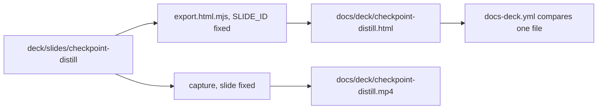
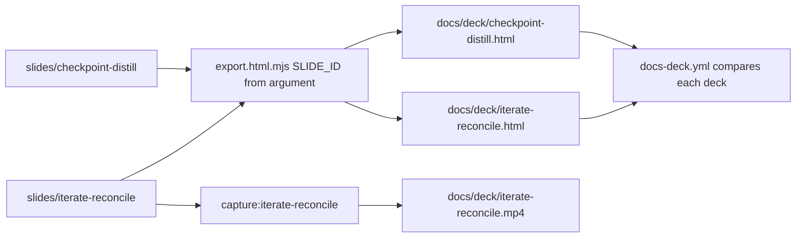
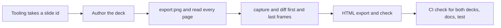

# Release Video for the Iterate and Reconcile Lifecycle: One-Shots Are Hard

## Change Summary

The governance 2.0.0 release replaces the single-CR iteration session with a lifecycle that ends on what the user kept: implement, iterate across every implemented CR, reconcile the CRs to the iteration, end. The repository teaches each release with a capture-first open-slide deck that is exported as a standalone page and a video under `docs/deck/`. Today there is one deck, `checkpoint-distill`, and the deck tooling and its CI check name it directly. This CR adds a second deck, `iterate-reconcile`, built on the premise "one-shots are hard", exports it to `docs/deck/iterate-reconcile.html` and `docs/deck/iterate-reconcile.mp4`, and generalises the tooling and the check so that both decks are built and checked.

## Motivation and Background

**The release changes how the user works, and the deck is how the repository shows it.** The previous release was introduced with a walkthrough video that a reader can watch in under a minute. The lifecycle of this release is a larger change: it moves the authority for user intent from the CR to the iteration. A reader who only reads `WORKFLOW.md` sees five steps; the video shows why they are in that order.

**The premise is the reason for the whole release.** A CR is written before anyone has seen the result. The first implementation is therefore approximately right, and the user learns what they meant by looking at it. A one-shot from specification to final code rarely lands. The deck opens on that premise and then shows the loop that accepts it rather than fighting it: implement, see, adjust, and then make the CR say what was kept.

**The tooling assumes one deck.** `deck/export.html.mjs` sets `SLIDE_ID = 'checkpoint-distill'`, `deck/check.export.mjs` defaults to `html-export/checkpoint-distill.html`, the `export:png` and `capture` scripts in `deck/package.json` name the slide, and `.github/workflows/docs-deck.yml` compares one file. A second deck cannot be exported or checked without changing these.

**The old deck stays.** The requestor chose to keep `checkpoint-distill` as the record of the previous release. Its closing skill list names `/checkpoint-iterate`, which this release renames; that page stays as it is.

## Change Drivers

* The governance 2.0.0 release needs a walkthrough video, like the previous release had
* "One-shots are hard" is the premise that motivates the release and must lead the story
* The deck scripts and the CI check are hard-wired to one deck
* The video must ship in the same pull request as the release, so the release and its video arrive together

## Current State

* `deck/slides/checkpoint-distill/index.tsx` (1059 lines) is the only deck. It is a loop variant: no step gating, mount-triggered CSS entrances with `both` fill, a transition on every page, and a final `Reset` page so that the first and last frames are identical.
* `DESIGN.md` holds the visual and motion rules ("Instrument Diagram"): colours, typography, layout safe area, transitions of 140 to 280 ms, morph rules, the snapshot contract, and ambient motion.
* `deck/README.md` documents the publishing procedure: edit, `export:png` and read every page, `capture` and diff the first and last frames, copy the MP4, rebuild and check the HTML export, commit both.
* `open-slide video` exists only on the fork at `~/Repo/github/1weiho/open-slide` (branch `feat/cli-capture-deck-as-video`, built `packages/core/dist`), installed with `npm install --no-save`. `ffmpeg` is on `PATH`.
* `deck/export.html.mjs` hard-codes `SLIDE_ID = 'checkpoint-distill'` and already uses its one positional argument, `process.argv[2]`, as the build directory (default `dist-single/`). It saves the download under `download.suggestedFilename()`, which open-slide derives from the deck.
* `deck/build.singlefile.mjs` builds the whole site and has no deck-specific logic, but its `@agents-index` line names `checkpoint-distill`.
* `.github/workflows/docs-deck.yml` rebuilds the export on a pull request that touches `deck/` or `docs/deck/` and fails when `docs/deck/checkpoint-distill.html` differs.
* `docs/deck/` holds `checkpoint-distill.html` and `checkpoint-distill.mp4`.

### Current State Diagram



## Proposed Change

### The Deck

A new deck at `deck/slides/iterate-reconcile/index.tsx`, authored with the same loop-variant rules and the same `DESIGN.md` system as `checkpoint-distill`, so the two read as one series. It reuses the visual primitives of the existing deck (Frame, Label, Heading, Terminal, FilePanel, Note, Facets, Backdrop) by copying them into the new file, per the small-file and isolation principle; the two decks do not import from each other.

The story has nine pages:

| # | Page | Label | Heading | What it shows |
|---|------|-------|---------|---------------|
| 1 | Problem | the problem | One-shots are hard. | The CR is written before anyone has seen the result. The first implementation is approximately right. |
| 2 | Implement | step 1 · implement | Ship the first version | `/implement-cr CR-XXXX CR-YYYY`: checkpoint commits, both CRs `implemented`, and the report line that names `/iterate-cr CR-XXXX CR-YYYY` |
| 3 | Iterate | step 2 · iterate | Now you see it. Now you know what you meant. | `/iterate-cr CR-XXXX CR-YYYY` and a ledger panel at `docs/cr/iterations/…` with entries attributed to CR-XXXX, CR-YYYY, and `none`, each a checkpoint commit |
| 4 | Drift | the drift | The CR still says what you first thought | A CR requirement next to the code that stands; the requirement no longer matches |
| 5 | Reconcile | step 3 · reconcile | The iteration is the ground truth | `/reconcile-cr`: one plan, CR-XXXX rewritten with a Reconciliation row (original, reconciled, entry, commit), a retroactive CR for the `none` entry |
| 6 | Explore | or start without a CR | Explore first, govern after | `/iterate-cr` with no CR, then `/reconcile-cr` writes a CR with `origin: retroactive` |
| 7 | Payoff | the payoff | The CR describes what you kept. | The reconciled CR as the next session reads it |
| 8 | Cta | the loop | Author, implement, iterate, reconcile | The lifecycle commands, the supporting checkpoint and distill skills, and `npx skills add desek/governance` |
| 9 | Reset | none | none | Bare ground, identical to frame 0 |

Placeholders `CR-XXXX` and `CR-YYYY` are used; no real CR identifier appears on a page.

### Exports

* `docs/deck/iterate-reconcile.html`: the standalone page from the open-slide HTML export, opened from disk, settled states only.
* `docs/deck/iterate-reconcile.mp4`: the capture at 30 fps with a dwell of 1600 ms, as for the existing deck, with first and last frames that match.

### Multi-Deck Tooling

* `export.html.mjs` takes the slide id as a flag, `--slide <id>`, defaulting to `checkpoint-distill`. The positional build-directory argument keeps its meaning and its default, so existing commands keep working. The script saves the export as `html-export/<slide-id>.html`, whatever name the download suggests, so every caller can name the file. Its docstring states the new usage.
* `check.export.mjs` already takes a path argument; its documentation names the per-deck usage.
* `package.json` gains per-deck scripts for the new deck (`export:png:iterate-reconcile`, `capture:iterate-reconcile`) and keeps the existing ones unchanged.
* `build.singlefile.mjs` keeps its logic; its `@agents-index` line is changed to describe a deck-agnostic build.
* `docs-deck.yml` builds and compares the export of every deck listed in one place in the workflow (`checkpoint-distill`, `iterate-reconcile`). On a mismatch it fails, names the stale file, and prints the fix commands for that deck.
* `deck/README.md` (the Layout block, the Commands block, the publishing steps, and the artifacts table) and `DESIGN.md` name both decks where they now name one.

### Proposed State Diagram



## Requirements

### Functional Requirements

1. A deck **MUST** exist at `deck/slides/iterate-reconcile/index.tsx` with the nine pages of the table above, in that order, ending with `Reset`.
2. Page 1 **MUST** state the premise "One-shots are hard" as its heading.
3. The deck **MUST** follow the loop-variant rules of the existing deck: no step gating, mount-triggered entrances with `both` fill, a transition on every page, and a final `Reset` page.
4. The deck **MUST** follow `DESIGN.md`: its palette, type scale, safe area, transition timing, and morph rules.
5. The commands, paths, commit subjects, and frontmatter fields shown on the pages **MUST** match the shipped skills: `/implement-cr`, `/iterate-cr`, `/reconcile-cr`, `docs/cr/iterations/`, `checkpoint(CR-XXXX-iterate)`, `checkpoint(iterate-{slug})`, `Iteration:`, `origin: retroactive`, `reconciled:`.
6. A page **MUST NOT** name `/checkpoint-iterate`, and a page **MUST NOT** show a real CR identifier.
7. `docs/deck/iterate-reconcile.html` **MUST** be the open-slide HTML export of the deck and **MUST** pass `check.export.mjs`.
8. `docs/deck/iterate-reconcile.mp4` **MUST** be a capture of the deck at 30 fps with a dwell of 1600 ms.
9. The first and last frames of the MP4 **MUST** match, with a per-channel mean difference below 1 on a 0 to 255 scale.
10. `export.html.mjs` **MUST** take the slide id as `--slide <id>` with the default `checkpoint-distill`, **MUST** keep the positional build-directory argument and its default, and **MUST** write the export to `html-export/<slide-id>.html`.
11. `docs-deck.yml` **MUST** check the export of both decks and, when one differs, **MUST** name the stale file and print the fix commands for that deck.
12. `deck/README.md` **MUST** document both decks in its Layout block, its Commands block, its publishing steps, and its artifacts table.
13. `checkpoint-distill` and its exports **MUST NOT** change.

### Non-Functional Requirements

1. Every page **MUST** keep its content inside the 1920 by 1080 canvas and the safe area, with no wrapped heading and no cropped content, verified by reading each PNG of `export:png`.
2. The fonts **MUST** stay embedded through `@fontsource-variable/*`; the export **MUST** make no network request.
3. Every new non-governance file **MUST** carry the copyright header of `AGENTS.md`.
4. The MP4 **MUST** stay under 5 MB.
5. The full Bats suite **MUST** pass with `bats -r tests/`.

## Affected Components

* `deck/slides/iterate-reconcile/index.tsx` (new)
* `deck/export.html.mjs`, `deck/check.export.mjs`, `deck/package.json`, possibly `deck/build.singlefile.mjs`
* `.github/workflows/docs-deck.yml`
* `deck/README.md`, `DESIGN.md`
* `docs/deck/iterate-reconcile.html`, `docs/deck/iterate-reconcile.mp4` (new)
* `tests/deck/test_iterate_reconcile_deck.bats` (new)

## Scope Boundaries

### In Scope

* The new deck, its two exports, and the multi-deck tooling and check
* Documentation of both decks in `deck/README.md` and `DESIGN.md`
* A structure test for the new deck

### Out of Scope ("Here, But Not Further")

* Any change to the `checkpoint-distill` deck or its exports, including its outdated skill list
* Audio, narration, or subtitles
* Automating video capture in CI; capture stays manual until `open-slide video` is released upstream
* Publishing the video anywhere other than `docs/deck/`
* A shared component library between the decks

## Alternative Approaches Considered

* **Add the new pages to the existing deck.** Rejected: the existing deck is the record of the previous release, and one long video teaches two releases at once.
* **Replace the existing deck.** Rejected by the requestor: the distill walkthrough would be lost.
* **Extract shared primitives into a module both decks import.** Rejected for this change: it changes the existing deck, which this CR keeps unchanged, and couples two files that change at different times.
* **Lead with the commands instead of the premise.** Rejected: the release exists because one-shots are hard; without that premise the reconcile step looks like ceremony.

## Impact Assessment

### User Impact

A reader of the release sees a short video that explains why the lifecycle iterates and reconciles, and can open the same walkthrough as a page from disk.

### Technical Impact

The deck scripts take a slide id; the existing commands keep their defaults. The CI check runs two exports instead of one, which adds about the time of one export to the Docs Deck job. The repository grows by one MP4 of a few MB.

### Business Impact

The release is easier to adopt, because the reason for the new steps is shown before the steps themselves.

## Implementation Approach

### Implementation Flow



### Detailed Implementation Steps

1. Add `--slide <id>` and the `<slide-id>.html` output name to `export.html.mjs`, add the per-deck scripts to `package.json`, and correct the `@agents-index` line of `build.singlefile.mjs`.
2. Author `deck/slides/iterate-reconcile/index.tsx`, copying the primitives of the existing deck and writing the nine pages.
3. Run `npm run export:png:iterate-reconcile` and read every PNG; fix crop, wrap, and size defects; repeat until clean.
4. Install the fork with `npm install --no-save ~/Repo/github/1weiho/open-slide/packages/core`, run `npm run capture:iterate-reconcile`, extract the first and last frames with `ffmpeg`, and compute the per-channel mean difference; fix the seam until it is below 1. Restore the published dependency afterwards with `npm ci`.
5. Run `npm run build:single`, the HTML export for the new deck, and `check.export.mjs` on it; copy both exports into `docs/deck/`.
6. Generalise `docs-deck.yml`, update `deck/README.md` and `DESIGN.md`, and add the structure test.

## Test Strategy

### Tests to Add

| Test File | Test Name | Description | Inputs | Expected Output |
|-----------|-----------|-------------|--------|-----------------|
| `tests/deck/test_iterate_reconcile_deck.bats` | `deck source exists` | The deck file is present | `deck/slides/iterate-reconcile/index.tsx` | File exists |
| `tests/deck/test_iterate_reconcile_deck.bats` | `deck ends with Reset` | Loop closure | same | Default export array ends with `Reset` |
| `tests/deck/test_iterate_reconcile_deck.bats` | `deck states the premise` | Premise on page 1 | same | Contains `One-shots are hard` |
| `tests/deck/test_iterate_reconcile_deck.bats` | `deck names the shipped commands` | Command accuracy | same | Contains `/implement-cr`, `/iterate-cr`, `/reconcile-cr`, `origin: retroactive` |
| `tests/deck/test_iterate_reconcile_deck.bats` | `deck does not name the retired command` | Rename | same | No `checkpoint-iterate` |
| `tests/deck/test_iterate_reconcile_deck.bats` | `exports are committed` | Artifacts | `docs/deck/` | `iterate-reconcile.html` and `iterate-reconcile.mp4` exist |
| `tests/deck/test_iterate_reconcile_deck.bats` | `CI checks both decks` | Workflow | `.github/workflows/docs-deck.yml` | Names both slide ids |

### Tests to Modify

Not applicable: no existing test asserts the deck tooling.

### Tests to Remove

Not applicable: no test becomes obsolete.

### Out-of-Band Verification

* `node check.export.mjs html-export/iterate-reconcile.html` exits 0.
* Every PNG of `export:png:iterate-reconcile` read back, with no crop or wrap.
* First and last frame per-channel mean difference below 1.
* The Docs Deck workflow passes on the pull request.

## Acceptance Criteria

### AC-1: The deck tells the story in order

```gherkin
Given deck/slides/iterate-reconcile/index.tsx
When the deck is rendered
Then its pages are Problem, Implement, Iterate, Drift, Reconcile, Explore, Payoff, Cta, Reset in that order
  And page 1 has the heading "One-shots are hard."
```

### AC-2: The pages match the shipped skills

```gherkin
Given the pages of the new deck
When a reader compares the commands, paths, and fields with skills/implement-cr, skills/iterate-cr, and skills/reconcile-cr
Then every command, path, commit subject, and field shown exists in those skills
  And no page names /checkpoint-iterate or a real CR identifier
```

### AC-3: Every page fits the canvas

```gherkin
Given the PNG export of the new deck
When each 1920 by 1080 page is read
Then no content is cropped, no heading wraps, and all content is inside the safe area
```

### AC-4: The video loops cleanly

```gherkin
Given docs/deck/iterate-reconcile.mp4
When its first and last frames are extracted
Then their per-channel mean difference is below 1
  And the file is under 5 MB
```

### AC-5: The page export opens from disk

```gherkin
Given docs/deck/iterate-reconcile.html
When check.export.mjs opens it from disk
Then it exits 0 and no page is blank
```

### AC-6: CI checks both decks

```gherkin
Given a pull request that touches deck/
When the Docs Deck workflow runs
Then it compares docs/deck/checkpoint-distill.html and docs/deck/iterate-reconcile.html with fresh exports
  And a stale export fails the job with the name of the stale file and the fix commands for that deck
```

### AC-7: The existing deck is unchanged

```gherkin
Given the change is complete
When git diff is run on deck/slides/checkpoint-distill and docs/deck/checkpoint-distill.*
Then it shows no change
  And node export.html.mjs with no argument still writes html-export/checkpoint-distill.html
```

### AC-8: The suite passes

```gherkin
Given the change is complete
When bats -r tests/ runs
Then every test passes
```

## Quality Standards Compliance

### Build & Compilation

- [ ] `npm run build` succeeds in `deck/`

### Linting & Code Style

- [ ] Copyright headers on new files
- [ ] The deck follows `DESIGN.md`

### Test Execution

- [ ] `bats -r tests/` passes
- [ ] `check.export.mjs` passes on the new export

### Documentation

- [ ] `deck/README.md` and `DESIGN.md` name both decks

### Code Review

- [ ] Changes submitted via pull request (PR #43)
- [ ] PR title follows Conventional Commits format
- [ ] Changes squash-merged to maintain linear history

### Verification Commands

```bash
cd deck
npm run build
npm run export:png:iterate-reconcile
npm run build:single && node export.html.mjs --slide iterate-reconcile && node check.export.mjs html-export/iterate-reconcile.html
cd .. && bats -r tests/
```

## Risks and Mitigation

### Risk 1: The fork for video capture does not build or run

**Likelihood:** low
**Impact:** high
**Mitigation:** The fork is checked out and built at `~/Repo/github/1weiho/open-slide`. If capture fails, the HTML export and the deck still ship, and the failure is reported rather than worked around.

### Risk 2: The new deck drifts from the shipped skills

**Likelihood:** medium
**Impact:** medium
**Mitigation:** The structure test asserts the command names, and AC-2 is checked against the skill files.

### Risk 3: The `npm install --no-save` of the fork leaks into the lockfile

**Likelihood:** low
**Impact:** medium
**Mitigation:** `--no-save` leaves `package.json` and the lockfile unchanged; `git diff deck/package-lock.json` is checked before commit, and `npm ci` restores the published dependency.

## Dependencies

* CR-0019, whose skills the deck teaches
* The open-slide fork with `open-slide video`, at `~/Repo/github/1weiho/open-slide`
* `ffmpeg` and a Playwright Chromium

## Estimated Effort

About half a day: two hours for the tooling and the deck, two hours for the visual and capture loop.

## Decision Outcome

Chosen approach: "a second capture-first deck that leads with the one-shot premise, with multi-deck tooling and a check for both decks", because it keeps the previous release's walkthrough intact, teaches the new lifecycle from its reason, and lets every future release add a deck without new tooling work.

## Related Items

* Links to related change requests: CR-0016, CR-0019
* Links to pull requests: #43
* Links to documentation: `deck/README.md`, `DESIGN.md`
