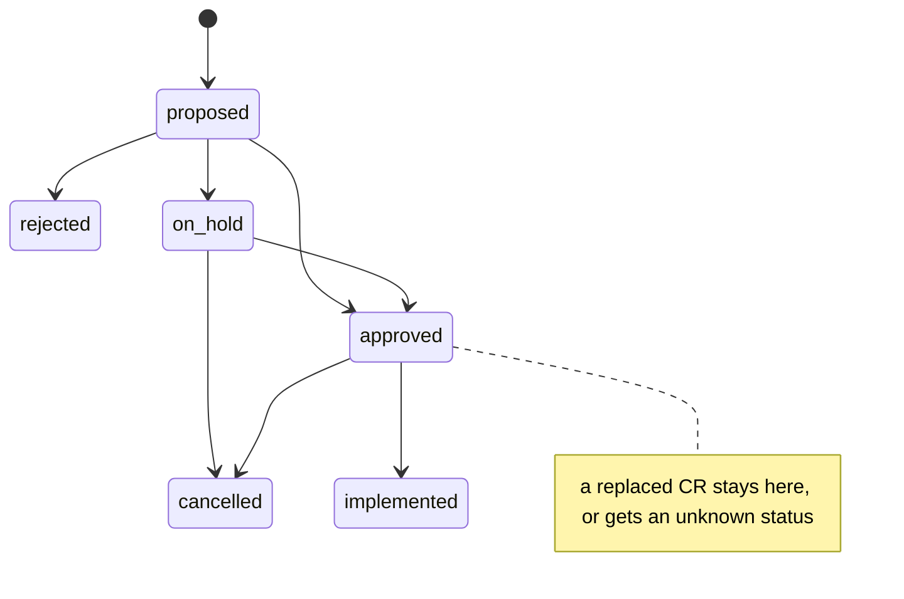
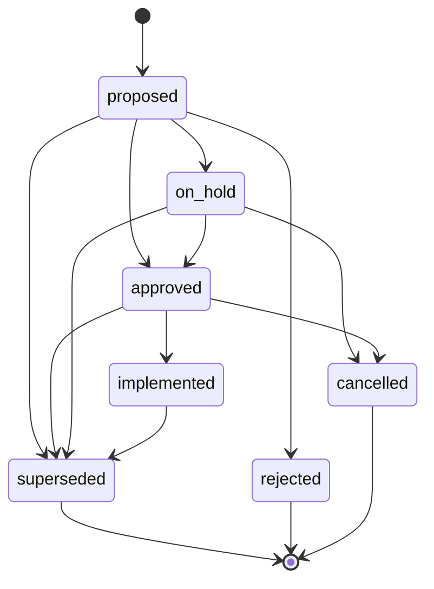
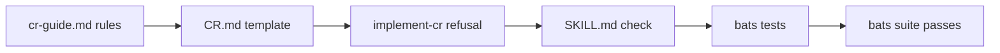

# Superseded Status and Superseded-By Field

## Change Summary

The CR lifecycle has no status for a CR whose goal was reached by one or more later CRs with a different design. Today such a CR stays `approved` or `proposed`, or gets a status the template does not know. This change adds the status `superseded` and the frontmatter field `superseded-by` (a list of CR ids), defines a short Supersession section for the superseded CR and a Related Items line for each successor, aligns the template status enum with every status of the guide's lifecycle table, and makes `/implement-cr` refuse a CR whose status ends its lifecycle without implementation.

## Motivation and Background

A consumer project of this skill had, on 2026-10-31, two approved CRs that were never implemented as written. Later CRs reached their goals with a different design:

- A CR for a conversational onboarding flow was replaced by a CR for a chat page and the CR that closed that work.
- A CR for a mail sender was replaced by a CR for a notification channel and a CR for a Microsoft 365 connector.

The project marked both CRs with `status: "superseded"` and a `superseded-by:` list. The template does not know that status or that field, so each project that meets the case invents its own shape. A third CR in the same project uses `obsolete`, which the guide's lifecycle table lists but the template's status line does not.

Without a status for the case, the list of open CRs (a `grep` of `status:` over `docs/cr/`) shows CRs that nobody will implement. A reader cannot tell an approved CR that waits for work from an approved CR whose goal is already met elsewhere. An agent that runs `/implement-cr` on such a CR builds a design that the project already replaced.

The existing statuses do not fit:

- `obsolete` means external factors invalidated the change. It names no successor CR, and the reader cannot follow the record to the CR that now holds the behaviour.
- `cancelled` means the change is no longer needed. In the observed case the change was needed and was delivered, by other CRs.
- `rejected` means the change was declined at review. Both CRs passed review.
- Reconciliation (CR-0019) rewrites an implemented CR in place to describe the behaviour that stands. It covers drift inside one CR, not a goal that moved to a different set of CRs.

## Change Drivers

* A real consumer project needed the status twice in one week and invented it.
* The open-CR list is wrong while the status is missing: it lists CRs that will never be implemented.
* The template and the guide disagree on the status set (`obsolete` is in the guide only), so a validator of the enum cannot be written today.
* `/implement-cr` accepts any CR file, whatever its status, and can build a replaced design.

## Current State

The template frontmatter carries:

```yaml
status: "{proposed | approved | rejected | implemented | on-hold | cancelled}"
```

The guide's CR Lifecycle table (`skills/governance/reference/cr-guide.md`) lists seven statuses: Proposed, Approved, Implemented, Rejected, On-Hold, Cancelled and Obsolete. The description of Obsolete is "Change is outdated due to external factors or superseded requirements", so the case of a successor CR is folded into obsolete, with no field that names the successor.

The Status Transitions block lists:

```
proposed → approved → implemented
proposed → rejected
proposed → on-hold → approved/cancelled
approved → cancelled
any status → obsolete (when externally invalidated)
```

The guide has a section "Reconciled and Retroactive CRs" for the two other shapes of a CR after its implementation. It has no shape for a replaced CR.

`skills/implement-cr/SKILL.md` step 2 resolves each argument to one CR file and stops on a missing or ambiguous file. It does not read the status.

No bats test compares the template enum with the guide's table.

### Current State Diagram



## Proposed Change

1. **The status `superseded`.** A CR is superseded when it is not, or no longer is, the record of the behaviour, because one or more named later CRs replaced its goal with a different design. The status is allowed from `proposed`, `approved`, `on-hold` and `implemented`. It is a terminal status.
2. **The field `superseded-by`.** A frontmatter list of CR ids, for example `superseded-by: ["CR-0042", "CR-0047"]`. The field is required when the status is `superseded` and absent otherwise. Each id names an existing CR in the same `docs/cr/` directory.
3. **The Supersession section.** The superseded CR gains a section `Supersession`: two sentences on what replaced it and why, then a table with the columns Criterion, Outcome and Evidence. Outcome is one of `met`, `superseded by CR-NNNN` or `dropped`. The rest of the CR stays as written, because Git holds the history and the CR records the design that was decided at its time. This is the opposite of a reconciled CR, which is rewritten in place.
4. **The successor line.** Each successor CR names the CR that it supersedes in its Related Items section.
5. **Obsolete narrowed.** The guide's description of `obsolete` drops "superseded requirements": obsolete means external factors invalidated the change and no successor CR exists.
6. **Enum alignment.** The template status line lists every status of the guide's table: proposed, approved, rejected, implemented, on-hold, cancelled, obsolete and superseded.
7. **Transitions.** The Status Transitions block gains the superseded transitions.
8. **Refusal in `/implement-cr`.** Step 2 refuses a CR whose status is `superseded`, `obsolete`, `cancelled` or `rejected`, names the CR and its status, and makes no commit.
9. **A bats test.** A test asserts that the template enum equals the guide's table and that the template documents `superseded-by`.

### Proposed State Diagram



The transition `any status → obsolete` stays as it is and is left out of the diagram for legibility.

## Requirements

### Functional Requirements

1. The template frontmatter status line **MUST** list exactly the statuses proposed, approved, rejected, implemented, on-hold, cancelled, obsolete and superseded.
2. The guide's CR Lifecycle table **MUST** list a row **Superseded** with the description: one or more named later CRs replaced the goal of the change with a different design.
3. The guide's description of **Obsolete** **MUST** state that external factors invalidated the change and that no successor CR exists.
4. The guide's Status Transitions block **MUST** list the transitions proposed, approved, on-hold and implemented to superseded.
5. The guide **MUST** state that `superseded` is terminal: a superseded CR does not move to another status.
6. The template frontmatter **MUST** document the field `superseded-by` as a list of CR ids, with a comment that it is present only when the status is `superseded`.
7. The guide **MUST** state that `superseded-by` is required when the status is `superseded`, absent otherwise, and that each id names an existing CR.
8. The guide **MUST** have a section "Superseded CRs" next to "Reconciled and Retroactive CRs" that defines the Supersession section (two sentences, then the table Criterion, Outcome, Evidence) and the allowed Outcome values `met`, `superseded by CR-NNNN` and `dropped`.
9. The guide **MUST** state that the body of a superseded CR stays as written and is not rewritten, unlike a reconciled CR.
10. The guide **MUST** state that each successor CR names the superseded CR in its Related Items section.
11. The template **MUST** carry an optional Supersession section with the table header, marked as present only when the status is `superseded`.
12. The template guideline block **MUST** carry an item for superseded CRs next to the item for reconciled and retroactive CRs.
13. `skills/implement-cr/SKILL.md` step 2 **MUST** refuse a CR whose status is `superseded`, `obsolete`, `cancelled` or `rejected`, name the argument and its status, and make no commit.
14. A bats test in `tests/governance/` **MUST** assert that the set of statuses in the template status line equals the set of statuses in the guide's lifecycle table.
15. A bats test in `tests/governance/` **MUST** assert that the template documents the field `superseded-by`.
16. `skills/governance/SKILL.md` **MUST** name the superseded end of the lifecycle in one line of its CR Lifecycle section only if that section lists the end states; otherwise it **MUST NOT** change.
17. The changelog entry **MUST** come from release-please and the commit type, with no manual edit of `CHANGELOG.md`.

### Non-Functional Requirements

1. The change **MUST NOT** put a governance identifier in a file outside the permitted territory of the reference boundary; `skills/implement-cr/SKILL.md` names statuses, not CR ids.
2. The new bats test **MUST** read the status sets from the two files, so a later status added to one file and not the other fails the test.
3. The existing bats suite **MUST** pass after the change.
4. The change **MUST** keep each file it touches readable without the others: the template states the field, the guide states the rules.

## Affected Components

* `skills/governance/templates/CR.md`: the status enum, the `superseded-by` field and its comment, a guideline item, an optional Supersession section.
* `skills/governance/reference/cr-guide.md`: the lifecycle table, the Obsolete description, the Status Transitions block and its bullets, a new section "Superseded CRs", the table of contents.
* `skills/governance/SKILL.md`: one line in CR Lifecycle, only per Functional Requirement 16.
* `skills/implement-cr/SKILL.md`: step 2, the status refusal.
* `tests/governance/test_cr_template.bats` or a new `tests/governance/test_cr_status.bats`: the enum and field tests.
* `CHANGELOG.md`: through release-please only.

## Scope Boundaries

### In Scope

* The status `superseded`, its transitions and its terminal rule.
* The field `superseded-by` and its rules.
* The Supersession section of the superseded CR and the Related Items line of each successor.
* The narrowed description of `obsolete`.
* The alignment of the template enum with the guide's table.
* The status refusal in `/implement-cr`.
* The bats tests for the enum and the field.

### Out of Scope ("Here, But Not Further")

* Renumbering of any CR.
* A migration of existing CRs in consumer projects; each project marks its own CRs.
* ADR statuses: the ADR template already has `superseded by ADR-NNNN`.
* A validator that checks that each id in `superseded-by` exists; the rule is stated in the guide, and a check is a later change.
* A change to `/iterate-cr` or `/reconcile-cr`.

## Alternative Approaches Considered

* **Use `obsolete` with a free-text note.** Rejected: obsolete names external invalidation, and a note is not machine-readable, so the open-CR list and a successor lookup stay manual.
* **Use `cancelled`.** Rejected: the goal was delivered, so "no longer needed" is false and hides where the behaviour lives.
* **Reconcile the replaced CR in place.** Rejected: reconciliation describes the behaviour that stands inside one CR. A replaced CR describes a design that was never built or that was replaced; rewriting it would erase the decision record and duplicate the successor CRs.
* **A single successor id instead of a list.** Rejected: both observed cases had two successors.
* **Delete the replaced CR.** Rejected: it removes the decision record and breaks references to it in Git history and in other CRs.

## Impact Assessment

### User Impact

Authors get one documented shape for a replaced CR. Readers of the open-CR list no longer see CRs that nobody will implement. An agent that runs `/implement-cr` on a closed CR gets a stop with the status named, not a build of a replaced design.

### Technical Impact

The change edits Markdown and one bats file. No script, hook or workflow changes. A consumer project that already uses `superseded` and `superseded-by` matches the new shape for the frontmatter; its Supersession section can differ and is out of scope.

### Business Impact

Low cost, removes one class of wasted implementation work and one class of wrong status report.

## Implementation Approach

1. Update `cr-guide.md`: the table, the Obsolete row, the transitions and bullets, the "Superseded CRs" section, the table of contents.
2. Update `templates/CR.md`: the enum, the `superseded-by` field with its comment, the guideline item, the optional Supersession section.
3. Update `implement-cr/SKILL.md` step 2 with the refusal.
4. Check `governance/SKILL.md` CR Lifecycle against Functional Requirement 16 and add one line only if it applies.
5. Add the bats tests and run the suite.

### Implementation Flow



## Test Strategy

### Tests to Add

* `tests/governance/test_cr_status.bats` (new), test "CR template status enum equals the guide lifecycle table":
  - Input: the status line of `$CR_TEMPLATE` and the bold first cells of the table under `## CR Lifecycle` in `$CR_GUIDE`.
  - Method: extract both sets, lower-case them, sort them, compare.
  - Expected: the sets are equal and contain eight statuses.
* Test "CR template documents superseded-by":
  - Input: `$CR_TEMPLATE`.
  - Expected: a frontmatter line starting with `superseded-by:` exists and its comment names the status `superseded`.
* Test "CR guide defines the Superseded CRs shape":
  - Input: `$CR_GUIDE`.
  - Expected: a heading `## Superseded CRs` exists, and it names the columns Criterion, Outcome and Evidence.
* Test "CR guide lists the superseded transitions":
  - Input: the Status Transitions block of `$CR_GUIDE`.
  - Expected: a transition to `superseded` from each of proposed, approved, on-hold and implemented.
* Test "implement-cr refuses closed statuses":
  - Input: `skills/implement-cr/SKILL.md`.
  - Expected: step 2 names each of `superseded`, `obsolete`, `cancelled` and `rejected`.

Copy the shape of `tests/governance/test_lifecycle.bats`: a `setup` that loads `test_helpers/setup.bash`, an `awk` helper that extracts one section, and `grep -q` assertions. Add a path variable for the implement-cr skill to `test_helpers/setup.bash` if no variable exists for it.

### Tests to Modify

* `tests/governance/test_cr_template.bats`: if a test asserts the old status line text, update it to the eight statuses.

### Tests to Remove

Not applicable. No test becomes redundant.

## Acceptance Criteria

### AC-1: The template enum equals the guide's table

```gherkin
Given the CR template and the CR guide after the change
When the bats suite extracts the status set of the template status line and of the guide lifecycle table
Then the two sets are equal
  And each set contains proposed, approved, rejected, implemented, on-hold, cancelled, obsolete and superseded
```

### AC-2: The template documents superseded-by

```gherkin
Given the CR template after the change
When a reader reads its frontmatter
Then a field superseded-by is present as a list of CR ids
  And its comment states that it is present only when the status is superseded
```

### AC-3: The guide defines superseded and narrows obsolete

```gherkin
Given the CR guide after the change
When a reader reads the CR Lifecycle table
Then the Superseded row states that named later CRs replaced the goal with a different design
  And the Obsolete row states external invalidation with no successor CR
```

### AC-4: The guide lists the superseded transitions

```gherkin
Given the CR guide after the change
When a reader reads the Status Transitions block
Then it lists a transition to superseded from proposed, approved, on-hold and implemented
  And it states that superseded is terminal
```

### AC-5: The guide defines the Supersession section

```gherkin
Given the CR guide after the change
When a reader reads the section Superseded CRs
Then it requires two sentences on what replaced the CR and why
  And a table with the columns Criterion, Outcome and Evidence
  And the Outcome values met, superseded by CR-NNNN and dropped
  And it states that the rest of the superseded CR stays as written
```

### AC-6: The successor names what it supersedes

```gherkin
Given the CR guide after the change
When a reader looks up the obligations of a successor CR
Then the guide requires a line in Related Items that names the superseded CR
```

### AC-7: implement-cr refuses a closed CR

```gherkin
Given a CR file whose status is superseded
When an agent runs /implement-cr with that CR
Then the run stops in step 2 before any work
  And it names the CR and the status superseded
  And it makes no commit
```

### AC-8: implement-cr refuses each closed status

```gherkin
Given the implement-cr skill after the change
When a reader reads step 2
Then it lists superseded, obsolete, cancelled and rejected as statuses it refuses
```

### AC-9: No identifier leaks out of the permitted territory

```gherkin
Given the change is complete
When the bats reference boundary test runs
Then it passes
```

### AC-10: The suite passes

```gherkin
Given the change is complete
When bats runs over tests/governance
Then every test passes
```

## Quality Standards Compliance

### Build & Compilation

- [ ] Not applicable: the change edits Markdown and bats only.

### Linting & Code Style

- [ ] Markdown follows the conventions of the existing guide and template.
- [ ] Mermaid diagrams render.

### Test Execution

- [ ] All existing tests pass after implementation
- [ ] All new tests pass

### Documentation

- [ ] The guide and the template agree on statuses and fields.
- [ ] `docs/llms.txt` lists this CR.

### Code Review

- [ ] Changes submitted via pull request
- [ ] PR title follows Conventional Commits format
- [ ] Code review completed and approved
- [ ] Changes squash-merged to maintain linear history

### Verification Commands

```bash
# Test execution
bats tests/governance

# Enum spot check
grep -n '^status:' skills/governance/templates/CR.md
awk '/^## CR Lifecycle$/{c=1;next} /^## /{c=0} c' skills/governance/reference/cr-guide.md | grep -o '^| \*\*[^*]*\*\*'
```

## Risks and Mitigation

### Risk 1: Authors use superseded where reconciliation fits

**Likelihood:** medium
**Impact:** medium
**Mitigation:** the guide states the distinction: reconciliation for drift inside one implemented CR, supersession when the goal moved to other named CRs.

### Risk 2: A superseded-by id goes stale after a renumbering

**Likelihood:** low
**Impact:** low
**Mitigation:** renumbering is out of scope and rare; the guide states that each id names an existing CR, and a validator is a later change.

### Risk 3: The enum test is brittle to formatting

**Likelihood:** medium
**Impact:** low
**Mitigation:** the test extracts tokens, lower-cases and sorts them, so order and capital letters do not matter.

## Dependencies

* CR-0019 defined reconciled and retroactive CRs; this CR places the superseded shape next to them.

## Estimated Effort

About two person-hours: one for the guide and the template, one for the skill step and the tests.

## Decision Outcome

Chosen approach: "a terminal status superseded with a required superseded-by list, a Supersession section that leaves the body as written, and a status refusal in /implement-cr", because it names the successors in a machine-readable field, keeps the decision record intact, and removes replaced CRs from the open list without overloading obsolete or cancelled.

## Related Items

* Links to related change requests: CR-0019 (reconciled and retroactive CRs)
* Links to documentation: `skills/governance/reference/cr-guide.md`, `skills/governance/templates/CR.md`

## More Information

Owner decision (2026-10-31): a successor CR carries no `supersedes` frontmatter field. The Related Items line is enough, and `superseded-by` on the superseded CR stays the single source of the link, so the two sides cannot disagree; the reverse lookup is one search for `superseded-by`.
