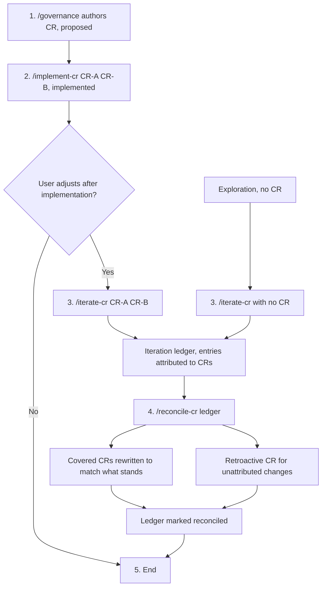

# Governance Documentation

Creates and manages governance documents: ADRs for architectural decisions, CRs for requirement changes.

## Document Selection

| Need | Document | Guide |
|------|----------|-------|
| Technical/architectural decision | ADR | [reference/adr-guide.md](reference/adr-guide.md) |
| Requirement or scope change | CR | [reference/cr-guide.md](reference/cr-guide.md) |

## Governance Reference Boundary

Governance identifiers (the `CR-`, `ADR-`, `FR-`, `NFR-`, and `AC-` prefixes followed by digits) belong in the governance corpus under `docs/` and in Git metadata — commit messages, branch names, and pull request descriptions — and **MUST NOT** be written into source code, test names, or user-facing documentation. To link an implementation back to its governance document, put the identifier in the commit message and describe the behavior itself in the code; see [reference/cr-guide.md#governance-reference-boundary](reference/cr-guide.md#governance-reference-boundary) for the full pattern definition, the permitted and prohibited territories, and the rationale.

## ADR Workflow

> **Documentation-only task.** Creating an ADR is a documentation-only task. No code compilation, test execution, or linting is required.

Use this checklist when creating an Architecture Decision Record:

```
- [ ] Read the template: templates/ADR.md
- [ ] Check docs/adr/ for the next available number
- [ ] Capture current branch (`git rev-parse --abbrev-ref HEAD`) and commit (`git rev-parse --short HEAD`)
- [ ] Create file: docs/adr/ADR-NNNN-{short-title}.md
- [ ] Fill in all required sections (including source-branch and source-commit in frontmatter)
- [ ] Set status to "proposed"
```

**Template frontmatter:** A created ADR carries its own `name` and `description` reflecting the specific decision, and no template metadata. The template's `name` and `description` describe the template itself, so replace them; the template carries no other metadata to copy.

**Strict requirements:**
- File naming: `ADR-NNNN-{title}.md` (four-digit number, lowercase, hyphens)
- Initial status: `proposed`
- Location: project's `docs/adr/` folder

**Flexible (adapt to context):**
- Level of detail in alternatives section
- Number of consequences listed
- Diagram inclusion (recommended for complex decisions)

## CR Workflow

> **Documentation-only task.** Creating a CR is a documentation-only task. No code compilation, test execution, or linting is required.

Use this checklist when creating a Change Request:

```
- [ ] Read the template: templates/CR.md
- [ ] Check docs/cr/ for the next available number
- [ ] Capture current branch (`git rev-parse --abbrev-ref HEAD`) and commit (`git rev-parse --short HEAD`)
- [ ] Create file: docs/cr/CR-NNNN-{short-title}.md
- [ ] Fill in all required sections (including source-branch and source-commit in frontmatter)
- [ ] Write acceptance criteria in Gherkin format
- [ ] Decide whether the change has a user surface: fill in the Model-Based Testing section if it does, remove the section if it does not
- [ ] Set status to "proposed"
```

**Template frontmatter:** A created CR carries its own `name` and `description` reflecting the specific change request, and no template metadata. The template's `name` and `description` describe the template itself, so replace them; the template carries no other metadata to copy.

**Strict requirements:**
- File naming: `CR-NNNN-{title}.md` (four-digit number, lowercase, hyphens)
- Initial status: `proposed`
- Location: project's `docs/cr/` folder
- Acceptance criteria: Gherkin format (Given-When-Then)
- Requirements keywords: RFC 2119 (MUST, SHOULD, MAY)

**Flexible (adapt to context):**
- Document length (minimum 250 lines for complex changes; no minimum for the part that specifies a user interface, which states behaviour, not words and pixels)
- Number of diagrams
- Depth of impact assessment
- Presence of the Model-Based Testing section (governed by the user-surface test)

### Implementing an Authored CR

Once a CR exists, [reference/cr-implementation-workflow.md](reference/cr-implementation-workflow.md) provides a project-agnostic agent-team workflow that carries it from review through phased implementation, finalization, validation, gap-fixing, and documentation. It follows the host project's own build, lint, and test conventions.

## CR Lifecycle

A change moves through five steps. Steps 3 and 4 run only when the user adjusts the result after implementation.

1. **Author.** Create the CR with this skill. Status `proposed`.
2. **Implement.** Run `/implement-cr` with one or many CRs. Each completed CR gets status `implemented`.
3. **Iterate (optional, user-initiated).** Run `/iterate-cr` with every CR the session covers. Each iteration ledger entry carries an attribution: the covered CR it changes, or `none`.
4. **Reconcile.** After the iteration is accepted, run `/reconcile-cr` on the ledger. The reconciled iteration ledger is the ground truth for user intent: each covered CR is rewritten to describe what was kept, and changes attributed to no covered CR go into a new retroactive CR.
5. **End.** The ledger is marked reconciled and the CRs are final. The lifecycle has ended.

**Exploration entry point.** A session may start at step 3 with no CR: `/iterate-cr` with no identifier opens an exploration ledger. When the user accepts the result, `/reconcile-cr` creates one retroactive CR (or more, if the work splits into independent changes) with status `implemented` and `origin: retroactive`.

When step 3 does not happen, the lifecycle ends after step 2. `/checkpoint-distill` stays optional after step 4, or after step 2 when no iteration ran: reconcile corrects the record of one change, distill extracts lessons for future work into the standing instructions.

**Checkpoint skills.** Every step that changes code commits through `/checkpoint-commit`, and starts, or resumes after context loss, with `/checkpoint-read`. `/reconcile-cr` changes no code: it makes one `docs(cr)` commit and reads the session commits with a scoped `git log` query.



See [reference/cr-guide.md](reference/cr-guide.md) for the reconciled and retroactive CR shapes.

## Templates

- **ADR**: [templates/ADR.md](templates/ADR.md)
- **CR**: [templates/CR.md](templates/CR.md)

## Reference Guides

For detailed lifecycle information, best practices, and examples:

- **ADR Guide**: [reference/adr-guide.md](reference/adr-guide.md)
- **CR Guide**: [reference/cr-guide.md](reference/cr-guide.md)
- **CR Implementation Workflow**: [reference/cr-implementation-workflow.md](reference/cr-implementation-workflow.md) — agent-team workflow for implementing an existing CR

## Commit Message Format

Committing governance documents is the human's responsibility. When ready to commit, use these formats:

- **ADR**: `docs(adr): add ADR-NNNN {title}`
- **CR**: `docs(cr): add CR-NNNN {title}`
